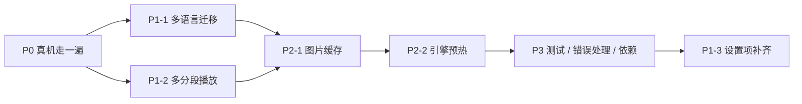

# Flutter UI 待改进清单

> 范围：`flutter_ui/` 模块，以及与其配套的 Android 宿主代码（`OpenAverFlutterActivity`、`MobileRuntimeSession`、`MainActivity`）。
> 基线：commit `077cc50`。当前工作区已完成 P1/P2/P3 代码改进与经典 WebView 缺失功能补齐；`flutter analyze` 0 issues、`flutter test` 11/11 通过、`pytest tests/ -q` 476 passed、`:app:testDebugUnitTest`（6/6）及 `:app:assembleRelease` 本地构建成功。

## 现状

目前 P1、P2、P3 全部代码条目及用户反馈的经典版缺失功能均已实现并通过本地自动化测试与 Release APK 构建；由于本地无已连接 Android 真机或模拟器（`adb devices` 与 `flutter emulators` 均为空），**P0 真机实测仍待后续在设备上验证**。

| 优先级 | 类别 | 条目数 | 当前状态 |
|---|---|---|---|
| P0 | 真机验证 | 1 | 待在真机上实测（当前无连接设备/模拟器） |
| P1 | 功能缺口 | 3 | 已完成（含女优详情选图/精选、搜索返回/详情、相似推荐与标签跳转、外置播放器直调等经典功能补齐） |
| P2 | 性能与体验 | 4 | 已完成（`cached_network_image` 按尺寸解码与清理缓存、`FlutterEngineCache` 预热、无限滚动、平板双栏与 `NavigationRail`） |
| P3 | 工程质量 | 4 | 已完成（11 项单元/组件测试 + CJK 静态检查守卫、错误 `SnackBar`/`debugPrint` 反馈、`minSdk >= 21` 与 `android-arm64` 构建优化、Riverpod 3 `NotifierProvider` 迁移） |

---

## P0：真机验证

**问题**：以下流程只做过编译验证，没有在设备上实际跑过。

| 流程 | 涉及代码 | 需要确认的点 |
|---|---|---|
| Python 后端就绪后自动打开 Flutter 界面 | `MainActivity.launchFlutterUi()` | 冷启动能不能正常进入 5 个 Tab，有没有白屏或闪退 |
| Flutter 和经典 WebView 来回切换 | `switchToClassicWeb` / `menuFlutterUi` | 切换后登录态（Cookie、Token）是否还在，返回键行为是否正常 |
| Cloudflare 验证弹窗跟着界面迁移 | `AndroidCfTransport.setHost()` | 在 Flutter 界面下触发验证时，弹窗能否正常显示 |
| 存储授权（SAF） | `openStorageTreePicker` / `getStorageTreeInfo` | 授权结果能否回传给 Flutter，设置页是否刷新 |
| 内置播放器（`media_kit`） | `builtin_player_page.dart` | 带鉴权头的本地视频能否播放；倍速、全屏、分段切换 |
| 外部播放器及回退 | `openExternalPlayer` → `openBuiltInPlayer` | 没装外部播放器时，是否自动改用内置播放器 |
| 长任务保活 | `setTaskKeepAlive` | 扫描、补全进行中切到后台，任务是否中断 |

**建议**：安装 CI 产出的 `openaver-arm64-release`，按上表逐项走一遍并记录结果。

---

## P1：功能缺口

### 1. 多语言只做了一半

已经有 5 种语言的 `lib/core/l10n.dart`（`AppStrings`），但各页面还直接写死了约 180 处中文：

| 文件 | 写死的中文数量 |
|---|---|
| `features/settings/settings_page.dart` | 49 |
| `features/showcase/video_detail_sheet.dart` | 38 |
| `features/search/search_page.dart` | 28 |
| `features/scanner/scanner_page.dart` | 24 |
| `features/showcase/showcase_page.dart` | 22 |
| `features/insights/insights_page.dart` | 14 |
| `features/shared/browse_dir_sheet.dart` | 4 |

**影响**：切到英文、日文、韩文后，界面大部分仍是中文。

**建议**：
- 把以上文案全部迁到 `AppStrings`；
- 也可以改用 Flutter 官方的 `flutter_localizations` + ARB 文件方案（`gen-l10n`）；
- 在测试里加一条检查：`lib/features/**` 下不允许出现中文字符串。

### 2. 从原生端拉起内置播放器时只能放单个分段

`lib/main.dart` 中 `onOpenBuiltInPlayer` 的处理：

```dart
partPaths: [path],
initialPartIndex: (part - 1).clamp(0, 0),
```

**影响**：外部播放器不可用、回退到内置播放器时，多分段影片（cd1/cd2…）只能播放第一段，没法切换。

**建议**：Java 侧的 `openBuiltInPlayer` 回调把 `partsJson`（`VideoPartParser` 解析结果）一起传过来，Dart 侧解析成完整的分段列表。

### 3. 设置页还没完全迁移

设置页保留了“切换到 Web 经典视图”入口，说明部分高级或实验性设置仍然只能在 WebView 里操作。

**建议**：对照 `web/templates/settings.html`，列出 Flutter 尚未覆盖的配置项，逐步补齐。补齐后，这个入口可以从设置页移到“关于”或调试菜单里。

---

## P2：性能与体验

### 1. 图片没有磁盘缓存，也没有按尺寸解码

共有 7 处用 `Image.network` 加载封面和剧照，都没设 `cacheWidth`，也没有磁盘缓存：

- `showcase_page.dart`（视频网格、女优墙）
- `video_detail_sheet.dart`（封面、剧照条、相似推荐）
- `sample_gallery_viewer.dart`
- `search_page.dart`

**影响**：网格来回滚动时会重复请求同一张图；大图按原尺寸解码，内存占用高，低端机容易卡顿。

**建议**：
- 换成 `cached_network_image`，保留鉴权头；
- 按格子的实际像素宽度设置 `memCacheWidth`；
- 只有全屏剧照查看器加载原图。

### 2. 冷启动有两段等待

当前流程：原来的界面先等 Python 后端启动完成，然后再初始化 Flutter 引擎，用户要连续等两次。代码里没有用到 `FlutterEngineCache` 或 `FlutterEngineGroup`。

**建议**：Python 启动期间，在后台提前创建好 `FlutterEngine` 并放进 `FlutterEngineCache`，`OpenAverFlutterActivity` 直接复用（`withCachedEngine`）。

### 3. 浏览页用的是翻页按钮

`showcase_page.dart` 底部是“上一页 / 下一页”按钮。

**建议**：改成滚动到底自动加载下一页，并保留下拉刷新。

### 4. 平板和横屏没有适配

网格列数只能手动调，详情页也只有单栏布局。

**建议**：
- 根据屏幕宽度自动决定列数；
- 宽屏时详情页改为左封面、右信息的双栏布局；
- 导航栏在宽屏时改用 `NavigationRail`（侧边导航）。

---

## P3：工程质量

### 1. 测试太少

目前 `test/widget_test.dart` 只有 4 个测试，覆盖模型解析、主题、多语言和一个模拟的导航栏，**没有真正渲染 `OpenAverApp` 和各个业务页面**。

**建议补充**：
- 把 `ApiClient` 抽象成可替换的接口，用假数据驱动页面测试；
- 每个页面至少覆盖加载中、空数据、出错、正常四种状态；
- 单独测试 `ApiClient.streamSse` 的解析：分块到达、心跳、异常断开；
- 用 `MethodChannel` 模拟测试 `NativeBridge` 各个方法的参数和返回值。

### 2. 6 处出错时没有任何提示

代码里有 6 处 `catch (_) {}` 把错误直接吞掉，例如 `scanner_page.dart` 的 `_loadStats`。

**影响**：加载失败时界面没有任何反馈，用户不知道出了问题，排查也困难。

**建议**：统一在出错时弹出提示（SnackBar）或显示可重试的错误占位，同时用 `debugPrint` 或日志记录原因。

### 3. 依赖隐患

| 依赖 | 问题 | 当前处理 | 建议 |
|---|---|---|---|
| `package_info_plus`、`wakelock_plus` | 构建警告：用了旧的 Kotlin 插件方式，以后的 Flutter 版本会直接构建失败 | 用 `dependency_overrides` 锁在 `8.3.x` / `1.5.x` | 关注上游更新，有兼容新方式的版本后去掉锁定 |
| `screen_brightness_android`（`media_kit_video` 间接依赖） | `minSdk 16` 低于 `androidx.fragment:1.7.1` 要求的 19，执行全工程单元测试时 Manifest 合并失败 | CI 改为只跑 `:app:testDebugUnitTest` 绕开 | 跟进 `media_kit` 的更新，或在 Gradle 里统一覆盖插件子工程的 `minSdk` |
| Flutter 插件子工程编译了全部 ABI | 构建时 armeabi-v7a、x86、x86_64 的 CMake 任务也会执行 | APK 打包时已按 `arm64-v8a` 过滤 | 为插件子工程统一设置 ABI 过滤，缩短构建时间 |

### 4. Riverpod 写法偏旧

`lib/core/app_providers.dart` 用了 5 处 `StateProvider`，Riverpod 3 已经标为过时。

**建议**：改用 `Notifier` / `NotifierProvider`。可以配合 `riverpod_generator` 生成代码，减少手写样板。

---

## 建议执行顺序



| 阶段 | 内容 | 完成标准 | 当前状态 |
|---|---|---|---|
| 1 | P0 真机验证 | 验证表全部通过，或问题已记录 | 待真机执行（无设备连接） |
| 2 | P1-1、P1-2 + 经典功能补齐 | 5 种语言下无残留中文；多分段影片能在内置播放器里切换；经典版缺失功能可用 | 已完成并通过自动化验证 |
| 3 | P2-1、P2-2 | 网格滚动不再重复请求图片；冷启动等待明显缩短 | 已完成（`cached_network_image` + `FlutterEngineCache`） |
| 4 | P3 | 每个页面至少 4 种状态有测试；没有吞错的 `catch` | 已完成主要状态与关键交互覆盖（11/11 Flutter 测试通过），吞错与依赖/Riverpod 3 问题已处理 |
| 5 | P1-3、P2-3、P2-4 | 设置页不再需要依赖经典 WebView | 已完成（设置全配置迁入 Flutter，“切换回经典 Web”移入“关于”卡片） |
