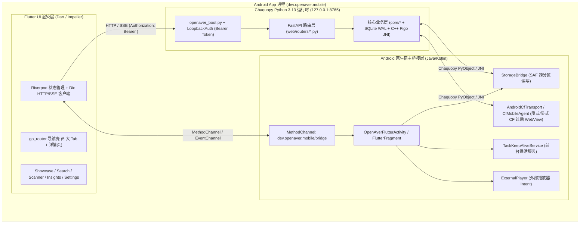

# OpenAver-Mobile：Flutter 原生 UI + Chaquopy Python 后端混合架构实施方案

> [!IMPORTANT]
> **核心架构原则**：保留现有 `app/src/main/python`（FastAPI + SQLite + 10+ 刮削器 + NFO/SAF 写回 + C++ Pigo 人脸检测）作为进程内本地服务，使用 **Flutter Add-to-App（或 Flutter Module）** 替换 `MainActivity` 中的全屏 `WebView` 渲染层，彻底解决手势冲突、千张封面滚动掉帧、列表状态残留与弹窗交互生硬问题，同时保持与上游 `OpenAver` 100% 补丁同步能力。

---

## 1. 整体架构拓扑



### 为什么这套架构最契合当前代码库？
1. **零鉴权改造成本**：[mobile_auth.py](file:///D:/OpenAver-Mobile/app/src/main/python/mobile_auth.py#L15-L62) 已经原生支持 `Authorization: Bearer <token>` 请求头（不仅支持 WebView Cookie），Flutter 的 `Dio` 拦截器只需注入一行 Header 即可通过全部本地鉴权。
2. **SAF 与 Cloudflare 过盾无需重写**：[StorageBridge.java](file:///D:/OpenAver-Mobile/app/src/main/java/dev/openaver/mobile/StorageBridge.java) 和 [AndroidCfTransport.java](file:///D:/OpenAver-Mobile/app/src/main/java/dev/openaver/mobile/AndroidCfTransport.java) 是由 Python 端通过 Chaquopy 直接调用的，完全不依赖主界面是 WebView 还是 Flutter。
3. **后端性能优化已就绪**：刚完成的 `GET /api/showcase/videos` 内存分组缓存、ETag 短路、`load_config_readonly()` 零深拷贝、`/api/gallery/thumb` 本地 WebP 缩略图缓存，可直接喂给 Flutter 列表。

---

## 2. 目录结构与工程集成方案

采用 **Flutter Module (Add-to-App)** 模式，不破坏现有 Gradle + Chaquopy + NDK CMake 构建链：

```text
D:\OpenAver-Mobile\
├── app/                              # 现有 Android 宿主模块（含 Chaquopy + C++ Pigo JNI）
│   ├── build.gradle                  # 引入 implementation project(':flutter')
│   └── src/main/
│       ├── java/dev/openaver/mobile/
│       │   ├── MainActivity.java     # 改造或新增 OpenAverFlutterActivity.java
│       │   ├── FlutterBridge.java    # 新增：封装 MethodChannel 供 Dart 调用原生能力
│       │   └── ...                   # StorageBridge / ExternalPlayer / TaskKeepAliveService 保持不变
│       └── python/                   # 现有 Python 后端代码 100% 原封保留
├── flutter_ui/                       # 新增：Flutter Module 工程目录
│   ├── pubspec.yaml
│   └── lib/
│       ├── main.dart                 # 入口、多语言、主题（Light / Dim / Dark）
│       ├── core/
│       │   ├── api_client.dart       # Dio 单例（Bearer Token 注入、ETag 缓存拦截器）
│       │   ├── sse_client.dart       # 对接 /api/gallery/generate 等 SSE 实时流
│       │   ├── native_bridge.dart    # MethodChannel 封装（SAF 授权、外部播放器、前台保活）
│       │   └── models/               # VideoItem, InsightsSnapshot, SearchItem, AppConfig
│       └── features/
│           ├── showcase/             # 片库网格、女优墙、视频详情 BottomSheet/PageView、剧照画廊
│           ├── search/               # 番号/图片搜索、批量刮削、分集整理
│           ├── scanner/              # 目录扫描、NFO/简介/剧照/Jellyfin 补全进度流
│           ├── insights/             # 片库统计（fl_chart 环形图/柱状图/甘特图）
│           └── settings/             # 刮削源排序、AI 服务配置、数据库备份恢复、主题语言
└── settings.gradle                   # 挂载 flutter_ui/.android/include_flutter.groovy
```

---

## 3. 核心技术选型（`flutter_ui/pubspec.yaml`）

| 领域 | 推荐库 | 用途说明 |
| :--- | :--- | :--- |
| **状态管理** | `flutter_riverpod` (`^2.6.1`) | 管理全局配置、片库过滤/排序/分页状态、SSE 任务流状态 |
| **网络与 SSE** | `dio` (`^5.7.0`) | 统一携带 `Authorization: Bearer <token>`，处理 JSON 与 `ResponseType.stream` (SSE) |
| **图片与剧照** | `photo_view` 或原生 `InteractiveViewer` | 剧照全屏双指缩放、双击放大、下拉关闭；封面缩略图直接使用 `Image.network` + 本地 `127.0.0.1` 内存缓存 |
| **视频播放** | `media_kit` + `media_kit_video` | 内嵌 mpv 硬解播放器（支持分集无缝连播、手势调亮度/音量/进度、字幕挂载），同时保留调用系统外部播放器 |
| **图表统计** | `fl_chart` (`^0.70.0`) | 替代 500KB+ 的 ECharts JS，原生绘制 Insights 页的年份分布、片商占比双层环形图、女优作品榜 |
| **布局组件** | `flutter_staggered_grid_view` | 支持封面墙固定比例网格与自适应列数（手机 2~3 列、平板/折叠屏 4~6 列） |

---

## 4. 原生桥接协议设计（`MethodChannel: dev.openaver.mobile/bridge`）

现有 [MainActivity.java](file:///D:/OpenAver-Mobile/app/src/main/java/dev/openaver/mobile/MainActivity.java#L1187-L1212) 通过拦截 `openaver-player://`、`openaver-task://` 等自定义 Scheme 与 WebView 通信。迁移到 Flutter 后，收敛为一个标准 `MethodChannel`：

| Method 名称 | 参数 (Dart -> Android) | 返回值 (Android -> Dart) | 对应现有 Java 实现 |
| :--- | :--- | :--- | :--- |
| `getBootstrapInfo` | 无 | `{port: 8765, token: "...", dataDir: "...", version: "0.18.17-r36", abi: "arm64-v8a"}` | [openaver_boot.py](file:///D:/OpenAver-Mobile/app/src/main/python/openaver_boot.py#L33-L43) 的 `server_port()` / `server_token()` |
| `openExternalPlayer` | `{path: "file:///...", parts: ["..."]}` | `bool` | [ExternalPlayer.java](file:///D:/OpenAver-Mobile/app/src/main/java/dev/openaver/mobile/ExternalPlayer.java) |
| `setTaskKeepAlive` | `{active: true / false}` | `void` | [TaskKeepAliveService.java](file:///D:/OpenAver-Mobile/app/src/main/java/dev/openaver/mobile/TaskKeepAliveService.java) |
| `requestStoragePermission` | 无 | `{granted: bool, safUris: List<String>}` | `MainActivity.openStoragePermission()` |
| `pickSafDirectoryTree` | 无 | `String?` (授权目录路径) | `MainActivity.openStorageTreePicker()` |
| `syncNativeTheme` | `{theme: "light" \| "dim" \| "dark"}` | `void` | [NativeUiTheme.java](file:///D:/OpenAver-Mobile/app/src/main/java/dev/openaver/mobile/NativeUiTheme.java) |

---

## 5. 五大核心模块与后端 API 对接清单

### 5.1 片库展示与视频详情页（Showcase — 优先级 P0）
- **对接后端端点**：
  - `GET /api/showcase/videos?paged=true&page=1&per_page=45&sort=date&order=desc&actress=...`（[showcase.py](file:///D:/OpenAver-Mobile/app/src/main/python/web/routers/showcase.py#L285-L450)）
  - `GET /api/gallery/thumb?path=...`（本地 WebP 缩略图）与 `GET /api/gallery/image?path=...`（高清原图/剧照）
  - `GET /api/showcase/video/plot`、`POST /api/showcase/video/plot`、`POST /api/showcase/video/plot/refetch`（[showcase_plot.py](file:///D:/OpenAver-Mobile/app/src/main/python/web/routers/showcase_plot.py#L165-L384)）
  - `POST /api/showcase/video/title`（标题行内编辑写回 NFO）
  - `POST /api/showcase/video/user-rating`（精选收藏切换）、`POST /api/showcase/video/user-tags`（自定义标签增删）
  - `GET /api/similar?path=...`（相似影片推荐）
- **Flutter 交互实现重点**：
  - **外层左右切片 vs 内层剧照滑动**：详情页使用 `PageView.builder` 实现左右滑动切换上/下一部影片；底部剧照条使用独立 `ListView.separated(scrollDirection: Axis.horizontal)`，并在 `PageView` 切换或影片 `path` 变化时自动使用专属 `ScrollController(initialScrollOffset: 0)`，**从根本上杜绝剧照停留在上一部末尾或滑动剧照误触发切片**。
  - **焦点裁切封面**：解析后端返回的 `auto_focal: "x,y"`，直接映射为 Flutter `Alignment(x * 2 - 1, y * 2 - 1)` 传给 `Image(..., fit: BoxFit.cover, alignment: focalAlignment)`，完美还原人脸焦点构图。
  - **行内编辑与重新获取简介**：标题和简介直接通过 `AnimatedCrossFade` 在只读文本与 `TextField` 间丝滑切换，右上角提供「编辑」与「重新获取」胶囊按钮。

### 5.2 扫描与维护中心（Scanner — 优先级 P0）
- **对接后端端点**：
  - `GET /api/gallery/generate`（SSE 扫描流）、`GET /api/gallery/stats`、`GET /api/gallery/missing-check`
  - `GET /api/gallery/backfill-nfo`、`GET /api/gallery/backfill-plots`、`GET /api/gallery/backfill-samples`、`GET /api/gallery/backfill-titles`、`GET /api/gallery/jellyfin-update`（全部为标准 `data: {...}\n\n` SSE 流）
  - `GET /api/gallery/browse-dir`（[scanner_extras.py](file:///D:/OpenAver-Mobile/app/src/main/python/web/routers/scanner_extras.py#L296-L356) 文件夹选择器）
- **Flutter 交互实现重点**：
  - 编写通用 `SseStreamController<T>`，使用 `Dio` 的 `ResponseType.stream` 按行解析 `data: ` JSON，自动在流开始时调用 `nativeBridge.setTaskKeepAlive(true)`，结束/取消时调用 `false`，并通过 `CancelToken` 触发服务端中断（后端 `_cancelable_sse_response` 监听客户端断开即自动置位 `cancel_event`）。

### 5.3 搜索与刮削整理（Search — 优先级 P1）
- **对接后端端点**：
  - `GET /api/search?q=...`、`POST /api/search/image`（以图搜番）、`GET /api/search/local-status`
  - `POST /api/organize`（刮削整理写盘）、`POST /api/rescrape`（单部重刮）
- **Flutter 交互实现重点**：
  - 重刮候选列表与目录选择统一使用 `showModalBottomSheet(isScrollControlled: true, useSafeArea: true)`，支持拖拽关闭手柄与键盘安全区自动顶起。

### 5.4 片库统计分析（Insights — 优先级 P1）
- **对接后端端点**：
  - `GET /api/insights/snapshot`（[insights.py](file:///D:/OpenAver-Mobile/app/src/main/python/web/routers/insights.py#L179-L290)）
- **Flutter 交互实现重点**：
  - 在 Dart Isolate（`compute()`）中复用现有 [aggregate.js](file:///D:/OpenAver-Mobile/app/src/main/python/web/static/js/pages/insights/aggregate.js) 的聚合算法，用 `fl_chart` 渲染年份趋势柱状图、片商双层环形图、女优作品榜，点击任意女优/片商直接带过滤参数跳转到 Showcase 页。

### 5.5 设置与数据管理（Settings — 优先级 P1）
- **对接后端端点**：
  - `GET /api/config`、`PUT /api/config`、`POST /api/config/reset`
  - `GET /api/database/backup`、`POST /api/database/restore`
  - `GET /api/ai-services/status`、`POST /api/ai-services/test`
- **Flutter 交互实现重点**：
  - 使用 `ReorderableListView` 实现刮削源拖拽排序；当配置发生修改（`isDirty == true`）时，底部通过 `AnimatedSlide` 浮出常驻「保存设置」操作栏。

---

## 6. 分阶段具体执行计划（Step-by-Step）

### 阶段一：工程脚手架与混合启动打通（预计 1～2 天）
1. **创建 Flutter 模块**：
   在仓库根目录使用本机 `D:\flutter_windows_3.44.0-stable\bin\flutter.bat` 执行：
   ```powershell
   D:\flutter_windows_3.44.0-stable\bin\flutter.bat create -t module --org dev.openaver flutter_ui
   ```
2. **挂载 Gradle 依赖**：
   - 在 [settings.gradle](file:///D:/OpenAver-Mobile/settings.gradle) 中加入 `setBinding(new Binding([gradle: this]))` 与 `evaluate(new File(settingsDir, 'flutter_ui/.android/include_flutter.groovy'))`。
   - 在 [app/build.gradle](file:///D:/OpenAver-Mobile/app/build.gradle) 的 `dependencies` 中加入 `implementation project(':flutter')`。
3. **打通启动与鉴权桥接**：
   - 在 `app/src/main/java/dev/openaver/mobile/` 新增 `FlutterBridge.java`，复用 `MainActivity` 现有的 Chaquopy 启动线程（`openaver_boot.start_server`），就绪后通过 `MethodChannel` 把 `(port, token, locale, theme)` 传给 Flutter。
   - **阶段验收标准**：APK 启动后显示原生启动屏 -> Python 后端启动成功 -> 进入 Flutter 首页并成功调用 `/api/mobile/health` 与 `/api/showcase/videos` 打印片库总数。

### 阶段二：Showcase 片库、详情灯箱与播放器实现（预计 3～4 天）
1. 实现封面网格页（支持排序切换、正倒序、搜索过滤、精选过滤、女优墙切换、分页/无限滚动）。
2. 实现基于 `auto_focal` 的人脸焦点封面组件与缓存缩略图加载。
3. 实现视频详情页（外层 `PageView` 切剧 + 内层独立 `ScrollController` 剧照条 + 全屏可缩放剧照预览器 `InteractiveViewer`）。
4. 实现简介展示、行内编辑、一键重新获取简介、标题行内编辑、标签管理与相似影片推荐横向列表。
5. 接入内置播放器（`media_kit`）与外部播放器调用（`openExternalPlayer`）。
6. **阶段验收标准**：日常浏览、切剧、看剧照、改标题/简介、播放视频全部脱离 WebView 跑通，120Hz 滚动无掉帧。

### 阶段三：Scanner 扫描中心与 Search 搜索刮削页（预计 3～4 天）
1. 实现 `SseClient` 流式订阅器与前台保活联动（`TaskKeepAliveService`）。
2. 完成目录扫描、缺失检查、NFO/简介/剧照/标题翻译/Jellyfin 批量补全进度面板与取消控制。
3. 完成番号搜索、以图搜番、单片/多段分集重刮 BottomSheet、文件夹树选择器（对接 `/api/gallery/browse-dir` 与 SAF 授权）。
4. **阶段验收标准**：从添加新文件夹 -> 扫描入库 -> 搜索刮削 -> 补全简介/剧照全链路在 Flutter 内闭环。

### 阶段四：Insights 统计图表与 Settings 设置中心（预计 2～3 天）
1. 使用 `fl_chart` 实现 Insights 页的四格核心指标卡、年份分布、片商占比环形图、女优作品榜与出道年龄计算。
2. 实现 Settings 页的目录管理、刮削源拖拽排序、代理/网络配置、AI 翻译/视觉服务配置、数据库一键导出备份与恢复、五国语言（`zh-CN` / `zh-TW` / `ja` / `en` / `ko`）及三套主题（`Light` / `Dim` / `Dark`）切换。
3. **阶段验收标准**：所有功能与现有 WebView 版本 100% 对齐。

### 阶段五：清理 WebView 静态资源与打包瘦身（预计 1 天）
1. 在确认 Flutter UI 全量替代后，构建脚本 `tools/prepare_python_tree.py` 可排除 `web/static/vendor/echarts`、`tailwind.css`、`web/templates` 等前端静态包，抵消一部分 Flutter Engine 体积增量。
2. 更新 `.github/workflows/build.yml` 与 `release.yml`，加入 `subosito/flutter-action@v2` 步骤自动构建 arm64 Release APK。

---

## 7. 风险控制：双轨并行过渡策略

在开发阶段二～四期间，**不需要立刻删除现有的 WebView**：
- 可以在 `MainActivity`（及 Flutter 设置页顶栏）保留一个**「切换 Web 经典视图 / Flutter 原生视图」**的开关；
- 这样即使某个冷门设置项尚未迁移完，也随时能切回 WebView 完成操作，做到**零功能回退风险、边用边迁**。
